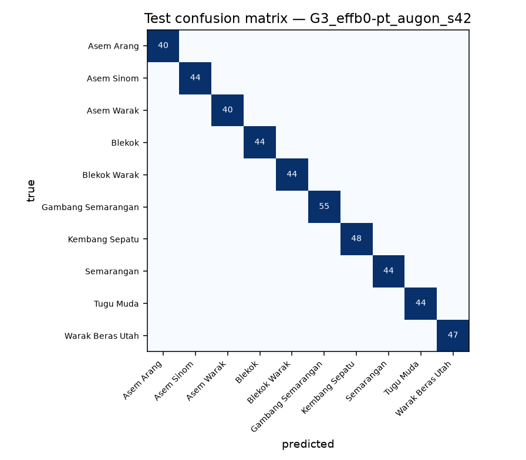
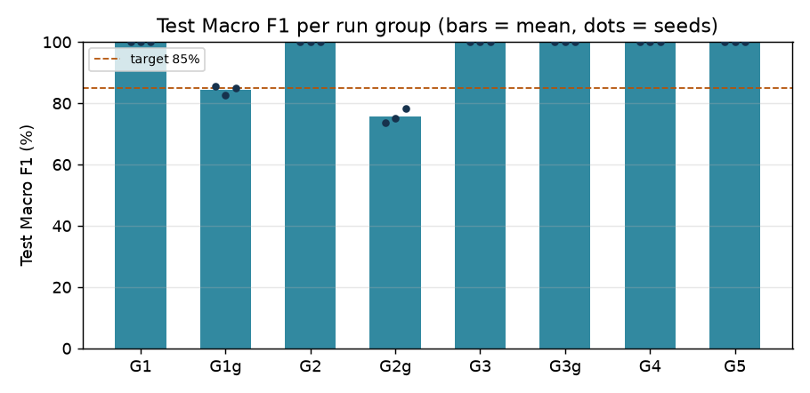
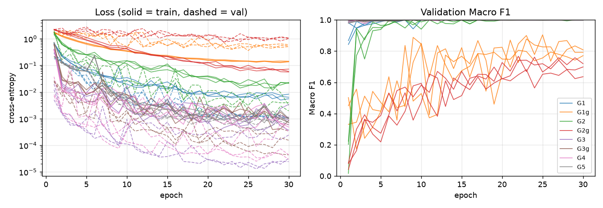
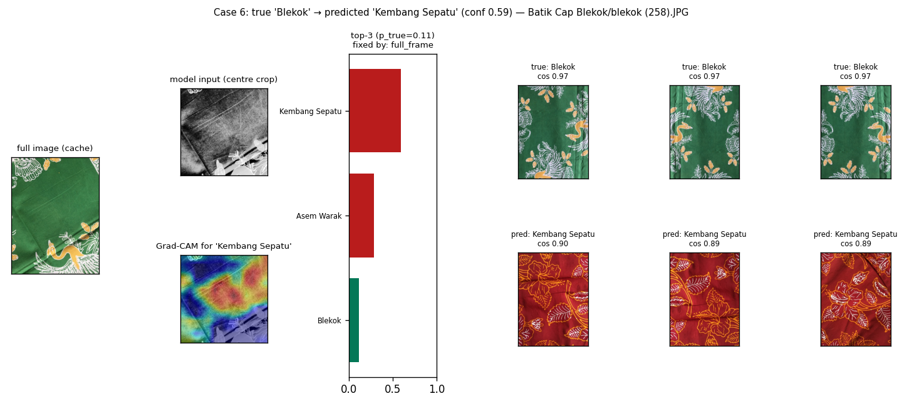
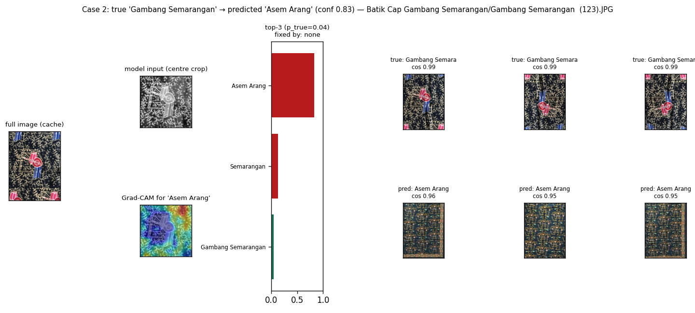

# Evaluasi From-Scratch CNN dan Fine-Tuned EfficientNet-B0 untuk Fine-Grained Classification Motif Batik Semarang

**Cakrawala University** · **Kelompok 5, Track A** · Tita Noviana, Titanio Yudista, Suci Fransisca Sisilia R., Fajar Dwiharjo

Repository: <https://github.com/Universitas-Cakrawala/semarang-batik-fine-grained-transfer-learning> · Model: [GitHub Release v1.0](https://github.com/Universitas-Cakrawala/semarang-batik-fine-grained-transfer-learning/releases/tag/v1.0) ·
Demo: [Hugging Face Space](https://huggingface.co/spaces/atsiduy/vision-classification-batik) ·
Slide presentasi: <https://batik-vision-deck.netlify.app/s/semarang-batik-results>

Semua angka di laporan ini kami ambil dari file di [`artifacts/`](https://github.com/Universitas-Cakrawala/semarang-batik-fine-grained-transfer-learning/tree/main/artifacts) dan [`data/manifests/`](https://github.com/Universitas-Cakrawala/semarang-batik-fine-grained-transfer-learning/tree/main/data/manifests) pada repository, jadi setiap angka bisa dicek ulang.

## 1. Problem statement dan kesesuaian deep learning

**Keputusan yang didukung.** Kami membangun model yang menerima foto kain lalu menebak motifnya dari 10 motif batik Semarang: Asem Arang, Asem Sinom, Asem Warak, Blekok, Blekok Warak, Gambang Semarangan, Kembang Sepatu, Semarangan, Tugu Muda, dan Warak Beras Utah. Model ini dimaksudkan untuk membantu kurasi dan pengarsipan. Model hanya memberi tiga saran teratas (top-3); label akhirnya tetap diputuskan kurator setelah memeriksa sendiri.

**Pengguna dan biaya kesalahan.** Pengguna yang kami bayangkan adalah kurator, peneliti tekstil, dan pengelola platform kriya. Kalau model salah memberi label (false positive), arsip menyimpan label yang keliru. Kalau model melewatkan motif yang sebenarnya ada (false negative), foto itu harus diperiksa ulang secara manual. Menurut kami kedua kesalahan ini sama merugikannya, dan jumlah gambar per kelas juga hampir seimbang, jadi kami memakai Macro F1 sebagai metrik utama.

**Mengapa deep learning.** Foto kain jarang rapi. Kainnya bisa terlipat, ukuran motifnya berubah-ubah, sudut pengambilannya berbeda, dan pencahayaannya tidak konsisten. Beberapa motif juga punya isen-isen yang mirip satu sama lain. Dengan fitur manual seperti SIFT/HOG, atau fitur warna dan tekstur seperti di paper dataset (Winarno dkk., 2024), fiturnya harus dirancang ulang untuk setiap variasi itu, sedangkan CNN mempelajari fiturnya langsung dari data. Klaim ini tidak kami terima begitu saja: di Bagian 4 kami membandingkan CNN dengan baseline non-deep pada split yang sama.

**Ruang lingkup.** Tugasnya klasifikasi closed-set dengan 10 kelas. Kami tidak membuat deployment produksi; yang ada hanya demo non-komersial, yaitu Gradio lokal dan Hugging Face Space.

## 2. Data

| Item | Nilai | Sumber artefak |
|---|---|---|
| Dataset | Semarang Batik Dataset, Kaggle `edywinarno/semarang-batik-dataset`, versi 2 (diperbarui 2023-10-16) | [`data/manifests/dataset_snapshot.json`](https://github.com/Universitas-Cakrawala/semarang-batik-fine-grained-transfer-learning/blob/main/data/manifests/dataset_snapshot.json) |
| Lisensi | CC BY-NC-SA 4.0 (proposal keliru menulis "Academic Research Use") | [`DATA_LICENSE.md`](https://github.com/Universitas-Cakrawala/semarang-batik-fine-grained-transfer-learning/blob/main/DATA_LICENSE.md) |
| Sitasi | Winarno, Septiarini, Hadikurniawati & Hamdani (2024), *ACM JOCCH* 17(2), doi:10.1145/3631131 | Metadata Kaggle |
| Arsip | 12.922.229.647 byte, SHA-256 `65710841…4fba93c` | [`dataset_snapshot.json`](https://github.com/Universitas-Cakrawala/semarang-batik-fine-grained-transfer-learning/blob/main/data/manifests/dataset_snapshot.json) |
| File | 3.020 JPEG, iPhone 6s, mayoritas 3024×4032; 650 file (21,7% dari 2.993 yang disertakan) memiliki rotasi EXIF | [`audit_summary.json`](https://github.com/Universitas-Cakrawala/semarang-batik-fine-grained-transfer-learning/blob/main/data/manifests/audit_summary.json) |
| Setelah audit | **2.993** gambar: 0 corrupt dan 27 exact duplicate dikeluarkan | [`exclusions.csv`](https://github.com/Universitas-Cakrawala/semarang-batik-fine-grained-transfer-learning/blob/main/data/manifests/exclusions.csv) |
| Class balance | 295–308 per kelas, rasio imbalance 1,04 | [`audit_summary.json`](https://github.com/Universitas-Cakrawala/semarang-batik-fine-grained-transfer-learning/blob/main/data/manifests/audit_summary.json), [`figures/class_distribution.png`](https://github.com/Universitas-Cakrawala/semarang-batik-fine-grained-transfer-learning/blob/main/figures/class_distribution.png) |
| Split | 2.090 / 453 / 450 (69,8 / 15,1 / 15,0%), seed 42 | [`split.csv`](https://github.com/Universitas-Cakrawala/semarang-batik-fine-grained-transfer-learning/blob/main/data/manifests/split.csv), [`split_meta.json`](https://github.com/Universitas-Cakrawala/semarang-batik-fine-grained-transfer-learning/blob/main/data/manifests/split_meta.json) (SHA-256 `32a0d9e2…`) |

**Preprocessing.** Setiap foto kami rotasi dulu sesuai tag EXIF, diubah ke RGB, lalu di-resize dengan LANCZOS sampai sisi terpendeknya 320 px. Hasilnya disimpan sebagai cache yang deterministik dan tidak bergantung pada label. Model menerima input 224×224. Saat evaluasi, gambar di-resize ke 256, di-CenterCrop 224, lalu dinormalisasi dengan statistik ImageNet.

**Leakage check eksplisit.** Sebelum membuat split, kami mengaudit snapshot dataset terlebih dahulu. Ada dua temuan yang akhirnya menentukan cara kami membagi data:

1. **Setiap jepretan disimpan sebagai sekitar 4 file hasil rotasi/flip.** Rata-rata ada 4,2 file per detik capture EXIF, maksimum 12 ([`inventory.csv`](https://github.com/Universitas-Cakrawala/semarang-batik-fine-grained-transfer-learning/blob/main/data/manifests/inventory.csv)). pHash biasa tidak bisa mendeteksi pasangan ini (jarak rata-ratanya 31,4), tetapi pHash yang invarian terhadap 8 transformasi dihedral bisa. Dari 5.195 pasangan dalam satu detik capture, 5.058 berjarak 0 dan 121 berjarak 2–4. Sisanya, 16 pasangan berjarak 24–26, hanya tertangkap oleh aturan timestamp. Sebagai perbandingan, dari seluruh 441.287 pasangan jepretan berbeda dalam kelas yang sama, persentil ke-5 jaraknya 20, dan hanya 150 pasangan yang berjarak ≤ 8; pasangan ini ikut digabung oleh aturan pHash ([`near_duplicate_edges.csv`](https://github.com/Universitas-Cakrawala/semarang-batik-fine-grained-transfer-learning/blob/main/data/manifests/near_duplicate_edges.csv)).
2. **Setiap kelas difoto dalam satu sesi.** Semua foto untuk satu kelas diambil pada tanggal yang sama dalam rentang 5,3–18,4 menit (`datetime_original` di [`inventory.csv`](https://github.com/Universitas-Cakrawala/semarang-batik-fine-grained-transfer-learning/blob/main/data/manifests/inventory.csv)). Dari pengamatan visual, semuanya juga berasal dari satu lembar kain dengan satu kombinasi warna.

Karena dua temuan ini, kami membagi data per grup foto sumber, bukan per gambar. Dua gambar dari kelas yang sama dimasukkan ke grup yang sama kalau memenuhi salah satu syarat berikut:
- detik capture EXIF sama;
- jarak pHash dihedral ≤ 8;
- cosine embedding ImageNet yang dipusatkan ≥ 0,95.

Threshold embedding kami kalibrasi dengan menjalankan `build_groups` pada dua nilai. Dengan 0,90, terbentuk 424 grup dan grup terbesarnya berisi 156 gambar, karena 2.456 edge yang hanya berasal dari embedding membuat grup saling berantai. Dengan 0,95, terbentuk 668 grup dengan grup terbesar 28 gambar, dan hanya 129 edge yang lolos lewat embedding saja.

Grup-grup ini lalu dibagi dengan StratifiedGroupKFold (20 fold: 14 untuk train, 3 untuk val, 3 untuk test), sehingga train berisi 470 grup, val 101 grup, dan test 97 grup.

Setelah split jadi, kami memverifikasinya ([`split_meta.json`](https://github.com/Universitas-Cakrawala/semarang-batik-fine-grained-transfer-learning/blob/main/data/manifests/split_meta.json), [`cross_split_nearest_train.csv`](https://github.com/Universitas-Cakrawala/semarang-batik-fine-grained-transfer-learning/blob/main/data/manifests/cross_split_nearest_train.csv)):
- tidak ada grup yang lintas split;
- jarak pHash dihedral minimum dari val/test ke train adalah 10;
- tidak ada detik capture yang sama antara val/test dan train;
- cosine maksimum ke train adalah 0,949.

Sebagai pembanding, kalau kami memakai split acak biasa seperti rencana di proposal, 98,9% gambar test (444 dari 449) akan punya salinan rotasi di data train ([`dataset_diagnostics.json`](https://github.com/Universitas-Cakrawala/semarang-batik-fine-grained-transfer-learning/blob/main/artifacts/metrics/dataset_diagnostics.json)).

**Shortcut warna.** Karena satu kelas sama dengan satu kain, warna dan kecerahan saja sudah bisa memisahkan kelas. Baseline non-deep berikut (logistic regression, nilai C dipilih pada validation) memperlihatkannya:

| Fitur (non-deep) | Input | Test Macro F1 |
|---|---|---:|
| Histogram warna HSV 16×8×8 | RGB | 100,00% |
| Histogram intensitas 32 bin | RGB | 99,09% |
| Histogram LBP 8-neighbour (tekstur) | RGB | 96,72% |
| Histogram intensitas | grayscale + equalization | 55,74% |
| Histogram LBP | grayscale + equalization | 96,26% |

Supaya perbandingan model tidak hanya menguji kemampuan membaca warna, kami menambahkan protokol grayscale + histogram equalization (G1g–G3g) di samping protokol RGB dari proposal. Protokol ini membuang warna dan kecerahan global, tetapi tekstur motifnya tetap ada. Hal ini terlihat dari baseline intensitas yang jatuh ke 55,74% pada input ini, sementara baseline LBP tetap 96,26%.

## 3. Baseline dan pendekatan yang diusulkan

| Group | Model | Parameter | Init | Input | Augmentation | Peran |
|---|---|---:|---|---|---|---|
| G1 | Custom CNN 4 blok (Conv3×3–BN–ReLU–MaxPool; 32/64/128/256 channel; GAP; Dropout 0,3; Linear) | 391.466 | Kaiming | RGB | ON | Baseline from-scratch |
| G2 | EfficientNet-B0 | 4.020.358 | Random | RGB | ON | Kontrol arsitektur |
| G3 | EfficientNet-B0 | 4.020.358 | ImageNet (`IMAGENET1K_V1`) | RGB | ON | Model transfer utama |
| G4 | EfficientNet-B0 | 4.020.358 | ImageNet | RGB | **OFF** | Ablation |
| G1g–G3g | Sama dengan G1–G3 | | | grayscale + eq. | ON | Protokol tanpa shortcut |
| G5 | EfficientNet-B0: linear probe 5 epoch (lr 1e-3), lalu unfreeze `features[5:]` 25 epoch (lr 1e-4) | | ImageNet | RGB | ON | Strategi training (suplemen) |

**Alasan pemilihan.**
- G1, G2, G1g, dan G2g dilatih from scratch, artinya mulai dari inisialisasi acak tanpa bobot pretrained. G3, G3g, dan G4 di-fine-tune penuh dari bobot ImageNet; semua layer ikut dilatih sejak epoch pertama. G5 di-fine-tune dua tahap: awalnya hanya head, lalu `features[5:]` dan head.
- G1 kami pakai sebagai baseline karena sederhana dan mudah dijelaskan.
- G2 diperlukan untuk memisahkan efek arsitektur dari efek pretraining. Tanpa G2, selisih G1 dan G3 mencampur dua efek itu sekaligus.
- G4 hanya berbeda dari G3 di augmentation. Unit test di [`tests/test_core.py`](https://github.com/Universitas-Cakrawala/semarang-batik-fine-grained-transfer-learning/blob/main/tests/test_core.py) memastikan konfigurasi lainnya benar-benar identik.

**Konfigurasi training (identik untuk semua run kecuali G5):**
- AdamW, lr 3e-4, weight decay 1e-4;
- batch 32, 30 epoch, cosine annealing per step;
- cross-entropy tanpa class weight;
- AMP fp16 di CUDA;
- tanpa early stopping;
- checkpoint dipilih berdasarkan validation Macro F1 (tie-break validation loss);
- test set dievaluasi sekali setelah training;
- seed 42, 43, dan 44.

**Augmentation ON:**
- RandomResizedCrop 224 dengan scale 0,8–1,0 dan ratio 0,75–1,33;
- HorizontalFlip dengan p=0,5;
- RandomAffine: rotasi ±15°, translate 5%, scale 0,9–1,1, shear 5°, area kosong
  diisi warna mean;
- ColorJitter: brightness, contrast, dan saturation 0,2; hue 0,02.

Inspeksi visual augmentation ada di [`figures/augmentation_grid.png`](https://github.com/Universitas-Cakrawala/semarang-batik-fine-grained-transfer-learning/blob/main/figures/augmentation_grid.png).

**Deviasi dari proposal** (lihat juga README):
- Two-stage fine-tuning kami pindahkan ke G5 supaya tidak mengacaukan perbandingan efek pretraining.
- ResNet-50 tidak kami jalankan.
- Threshold keberhasilan kami perjelas menjadi +10 *percentage points*.

## 4. Hasil

Sumber: [`artifacts/metrics/tables.md`](https://github.com/Universitas-Cakrawala/semarang-batik-fine-grained-transfer-learning/blob/main/artifacts/metrics/tables.md) (dihasilkan oleh `batik aggregate`). Semua angka adalah Macro F1 pada test split beku (450 gambar), dalam bentuk mean ± std dari seed 42/43/44.

| Group | Konfigurasi | Parameter | Test Macro F1 (%) | Test Acc (%) | Test Top-3 (%) | Val Macro F1 (%) | Waktu / run (menit) |
|---|---|---:|---:|---:|---:|---:|---:|
| G1 | Custom CNN, scratch, aug ON | 391.466 | 100,00 ± 0,00 | 100,00 ± 0,00 | 100,00 ± 0,00 | 100,00 ± 0,00 | 18,7 |
| G2 | EfficientNet-B0, scratch, aug ON | 4.020.358 | 100,00 ± 0,00 | 100,00 ± 0,00 | 100,00 ± 0,00 | 100,00 ± 0,00 | 14,6 |
| G3 | EfficientNet-B0, ImageNet, aug ON | 4.020.358 | 100,00 ± 0,00 | 100,00 ± 0,00 | 100,00 ± 0,00 | 100,00 ± 0,00 | 17,8 |
| G4 | EfficientNet-B0, ImageNet, aug OFF | 4.020.358 | 100,00 ± 0,00 | 100,00 ± 0,00 | 100,00 ± 0,00 | 100,00 ± 0,00 | 9,2 |
| G5 | EfficientNet-B0, ImageNet, two-stage | 4.020.358 | 100,00 ± 0,00 | 100,00 ± 0,00 | 100,00 ± 0,00 | 100,00 ± 0,00 | 15,0 |
| G1g | Custom CNN, scratch, grayscale-eq | 391.466 | 84,41 ± 1,45 | 85,04 ± 1,28 | 98,67 ± 1,60 | 87,72 ± 2,74 | 12,0 |
| G2g | EfficientNet-B0, scratch, grayscale-eq | 4.020.358 | 75,66 ± 2,38 | 75,70 ± 1,67 | 98,30 ± 0,26 | 73,02 ± 4,39 | 14,1 |
| G3g | EfficientNet-B0, ImageNet, grayscale-eq | 4.020.358 | 100,00 ± 0,00 | 100,00 ± 0,00 | 100,00 ± 0,00 | 100,00 ± 0,00 | 13,8 |

Tabel per run ada di [`tables.md`](https://github.com/Universitas-Cakrawala/semarang-batik-fine-grained-transfer-learning/blob/main/artifacts/metrics/tables.md).

**Protokol RGB mencapai ceiling.** Semua model RGB mendapat Macro F1 100% di ketiga seed, termasuk Custom CNN yang hanya punya 0,39 M parameter. Angka ini sama dengan logistic regression di atas histogram warna HSV (Bagian 2). Jadi di protokol ini deep learning tidak lebih baik daripada baseline non-deep, dan karena semua skornya sempurna, kami tidak bisa membedakan model mana yang lebih baik.

**Protokol grayscale membedakan model.**
- G3g (transfer) tetap 100,00%, lebih tinggi daripada baseline non-deep terbaik pada input yang sama (LBP + logistic regression, 96,26%).
- G1g (84,41%) dan G2g (75,66%) justru berada di bawah baseline LBP itu. Dengan hanya 2.090 gambar train, kedua model from-scratch belum bisa mempelajari tekstur motif sebaik fitur LBP yang dirancang manual.

**Kecepatan konvergensi** ([`artifacts/runs/*/history.csv`](https://github.com/Universitas-Cakrawala/semarang-batik-fine-grained-transfer-learning/tree/main/artifacts/runs), epoch pertama dengan val Macro F1 ≥ 0,99 di ketiga seed): G3 dan G3g sudah mencapainya di epoch 1, G4 di epoch 1–2, G5 di epoch 2, G1 (RGB) di epoch 2–4, dan G2 di epoch 6–7. G1g dan G2g tidak pernah mencapainya selama 30 epoch.

**Status target proposal** ([`summary.json`](https://github.com/Universitas-Cakrawala/semarang-batik-fine-grained-transfer-learning/blob/main/artifacts/metrics/summary.json) → `headline`):

| Target | Hasil | Status |
|---|---|---|
| Macro F1 G3 ≥ 85% | 100,00 ± 0,00% | Tercapai |
| Gain G3 atas G1 ≥ +10 pp (RGB) | +0,00 pp | **Tidak tercapai** (kedua model di ceiling) |
| Gain yang sama pada protokol grayscale (G3g vs G1g) | +15,59 ± 1,45 pp | Tercapai, CI semua seed > 0 |

Karena ceiling effect, hipotesis proposal tidak bisa diuji pada protokol RGB. Hasil ini memang berbeda dari yang kami harapkan di proposal, tetapi kami memilih melaporkannya apa adanya. Pada protokol grayscale, saat model harus mengandalkan tekstur motif, hipotesis itu didukung.

## 5. Ablation

Sumber: tabel *paired comparisons* di [`tables.md`](https://github.com/Universitas-Cakrawala/semarang-batik-fine-grained-transfer-learning/blob/main/artifacts/metrics/tables.md). Δ adalah Macro F1 A − B dalam percentage points, dipasangkan per seed. CI-nya 95% paired bootstrap per seed (2.000 resample test set). Kalau CI suatu selisih mencakup 0, kami tidak menyebutnya sebagai perbedaan.

| A vs B | Pertanyaan | Mean Δ ± std (pp) | 95% CI per seed (pp) | Interpretasi |
|---|---|---:|---|---|
| G3 vs G1 | Headline: transfer vs from-scratch | 0,00 ± 0,00 | [0,0; 0,0] × 3 | Tidak ada perbedaan (ceiling) |
| G2 vs G1 | Efek arsitektur | 0,00 ± 0,00 | [0,0; 0,0] × 3 | Tidak ada perbedaan (ceiling) |
| G3 vs G2 | Efek pretraining | 0,00 ± 0,00 | [0,0; 0,0] × 3 | Tidak ada perbedaan (ceiling) |
| G3 vs G4 | Efek augmentation | 0,00 ± 0,00 | [0,0; 0,0] × 3 | Tidak ada perbedaan pada test bersih; lihat robustness |
| G5 vs G3 | Two-stage vs full fine-tuning | 0,00 ± 0,00 | [0,0; 0,0] × 3 | Tidak ada perbedaan (ceiling) |
| G3g vs G1g | Transfer vs from-scratch (grayscale) | **+15,59 ± 1,45** | s42 [11,5; 17,8]; s43 [13,9; 21,1]; s44 [12,2; 18,1] | Transfer lebih baik; CI semua seed > 0 |
| G2g vs G1g | Efek arsitektur (grayscale) | **−8,75 ± 2,78** | s42 [−16,0; −7,7]; s43 [−11,9; −3,2]; s44 [−10,7; −2,9] | EfficientNet-B0 scratch **lebih buruk** daripada CNN kecil |
| G3g vs G2g | Efek pretraining (grayscale) | **+24,34 ± 2,38** | s42 [23,3; 29,8]; s43 [21,7; 28,5]; s44 [18,5; 25,2] | Efek terbesar; CI semua seed > 0 |
| G3 vs G3g | Kontribusi warna untuk model transfer | 0,00 ± 0,00 | [0,0; 0,0] × 3 | Model transfer yang dilatih tanpa warna tetap 100%; warna tidak diperlukan jika fitur pretrained dipakai |

**Interpretasi.** Keunggulan G3g atas G1g (+15,6 pp) tidak datang dari arsitektur. Dengan inisialisasi acak, EfficientNet-B0 malah 8,8 pp di bawah CNN yang jauh lebih kecil. Log training juga menunjukkan gejala overfitting: di epoch 30, akurasi train G2g 97,8–98,4%, sedangkan akurasi validation-nya hanya 65,1–72,2% (G1g: 97,7–98,2% vs 79,0–80,6%). Dugaan kami, penyebabnya adalah jumlah parameter G2g yang mencapai 4,0 M sementara data train hanya 2.090 gambar, tetapi dugaan ini belum kami uji secara terpisah. Selisih terbesar justru datang dari bobot pretrained ImageNet, yang menambah 24,3 pp atas G2g.

**Robustness** ([`artifacts/metrics/robustness.md`](https://github.com/Universitas-Cakrawala/semarang-batik-fine-grained-transfer-learning/blob/main/artifacts/metrics/robustness.md); satu run per group, jadi tidak ada CI). Setiap kolom memakai run final dari group tersebut, yang dipilih oleh `select_final_run` ([`src/batik/analysis.py`](https://github.com/Universitas-Cakrawala/semarang-batik-fine-grained-transfer-learning/blob/main/src/batik/analysis.py)): run dengan validation Macro F1 tertinggi, dan seed terkecil kalau seri. Hasilnya seed 42 untuk G1, G2, G3, G4, G1g, dan G3g, serta seed 44 untuk G2g. G5 tidak kami uji robustness. Corruption hanya diterapkan saat evaluasi, dengan 3 tingkat severity:

| Kondisi (Macro F1 %) | G1 | G2 | G3 | G4 (aug OFF) | G1g | G2g | G3g |
|---|---:|---:|---:|---:|---:|---:|---:|
| Clean | 100,00 | 100,00 | 100,00 | 100,00 | 85,49 | 78,26 | 100,00 |
| Brightness s3 | 66,10 | 67,04 | 99,32 | 94,92 | 84,13 | 77,71 | 100,00 |
| Contrast s3 | 99,19 | 73,38 | 100,00 | 90,82 | 78,99 | 77,89 | 100,00 |
| Occlusion s3 | 100,00 | 45,74 | 100,00 | 56,34 | 18,71 | 32,33 | 94,86 |
| Blur s1 | 100,00 | 99,55 | 99,77 | 100,00 | 26,09 | 35,12 | 99,28 |
| Blur s3 | 61,07 | 46,19 | 98,63 | 72,50 | 8,93 | 6,13 | 35,15 |
| Probe grayscale | 7,32 | 21,89 | 67,42 | 34,66 | 85,49 | 78,26 | 100,00 |
| Probe grayscale-eq | 5,96 | 12,38 | 32,87 | 31,90 | 85,49 | 77,97 | 100,00 |

Temuan robustness:
1. **Ketergantungan warna.** Ketiga model RGB mendapat 100% di test bersih, tetapi saat diberi probe grayscale, G1 turun ke 7,3%, G2 ke 21,9%, dan G3 ke 67,4%. Artinya model RGB banyak bergantung pada warna, dan hanya G3 yang masih mengenali sebagian tekstur.
2. **Augmentation baru terasa saat gambar diganggu.** G3 dan G4 sama-sama 100% di test bersih. Namun pada occlusion s3, G3 tetap 100,00% sementara G4 turun ke 56,34%. Pada blur s3 hasilnya 98,63% vs 72,50%, dan pada contrast s3 100,00% vs 90,82%.
3. **Model from-scratch sangat sensitif terhadap blur.** Blur tingkat 1 saja sudah menurunkan G1g dari 85,5% ke 26,1% dan G2g dari 78,3% ke 35,1%. Dugaan kami, kedua model grayscale from-scratch bergantung pada detail halus yang hilang saat gambar diburamkan.
4. **Rotasi, perspektif, dan deformasi elastis** hampir tidak mengubah hasil model RGB, termasuk G4 yang dilatih tanpa augmentation. Kemungkinan penyebabnya, data train sudah berisi salinan rotasi atau flip dari setiap jepretan (Bagian 2).

## 6. Error analysis

Sumber: [`artifacts/error_analysis/G1g_customcnn-scratch_augon_s42/cases.json`](https://github.com/Universitas-Cakrawala/semarang-batik-fine-grained-transfer-learning/blob/main/artifacts/error_analysis/G1g_customcnn-scratch_augon_s42/cases.json) dan
[`figures/errors/G1g_customcnn-scratch_augon_s42/case_01–10.png`](https://github.com/Universitas-Cakrawala/semarang-batik-fine-grained-transfer-learning/tree/main/figures/errors/G1g_customcnn-scratch_augon_s42).

**Pemilihan model.** Model final G3, G3g, dan G1 tidak membuat satu pun kesalahan pada test set, jadi aturan fallback awal kami (G3 → G3g → G1) tidak menghasilkan kasus untuk dianalisis. Setelah melihat hasil ini, kami memperluas aturannya ke G1g lalu G2g. Model yang akhirnya dipakai adalah run final G1g seed 42 (val Macro F1 tertinggi di G1g), dengan 64 error dari 450 gambar. Sepuluh kasus kami pilih bergiliran per pasangan kebingungan, dimulai dari kasus yang paling yakin di setiap pasangan.

**Distribusi error.** Error paling banyak terjadi pada dua pasangan: Asem Warak ditebak sebagai Kembang Sepatu 23 kali (36% dari 64 error), dan Gambang Semarangan ditebak sebagai Asem Arang 11 kali.

**Intervensi.** Setiap gambar yang salah kami prediksi ulang dengan lima perubahan input: *full frame* (seluruh foto di-resize ke 224 tanpa crop), *grayscale*, *horizontal flip*, *normalisasi brightness* ke rata-rata train, dan *5-crop*. Intervensi grayscale tidak berpengaruh pada G1g karena inputnya sudah grayscale.

| # | File | Label → Prediksi (conf.) | Top-3 | Diperbaiki oleh | Sharpness / median kelas |
|---:|---|---|---|---|---:|
| 1 | `asem warak (61).JPG` | Asem Warak → Kembang Sepatu (0,94) | KS, AW, Blekok | — | 3.868 / 3.455 |
| 2 | `Gambang Semarangan (123).JPG` | Gambang Semarangan → Asem Arang (0,83) | AA, Semarangan, GS | — | 14.092 / 21.261 |
| 3 | `Kembang Sepatu (99).JPG` | Kembang Sepatu → Asem Arang (0,67) | AA, KS, Semarangan | full frame (p=0,99), 5-crop | 5.389 / 8.484 |
| 4 | `blekok (274).JPG` | Blekok → Asem Sinom (0,65) | AS, Blekok, AW | — | 1.761 / 6.130 |
| 5 | `Asem Sinom (82).JPG` | Asem Sinom → Warak Beras Utah (0,60) | WBU, AS, Blekok Warak | hflip | 1.319 / 967 |
| 6 | `blekok (258).JPG` | Blekok → Kembang Sepatu (0,59) | KS, AW, Blekok | full frame | 1.811 / 6.130 |
| 7 | `Asem Sinom (149).JPG` | Asem Sinom → Kembang Sepatu (0,53) | KS, AS, Blekok | full frame (p=0,71), 5-crop | 618 / 967 |
| 8 | `Tugu Muda (122).JPG` | Tugu Muda → Warak Beras Utah (0,35) | WBU, TM, Semarangan | full frame | 7.091 / 15.874 |
| 9 | `Tugu Muda (123).JPG` | Tugu Muda → Semarangan (0,31) | Semarangan, WBU, TM | full frame | 7.091 / 15.874 |
| 10 | `Asem Sinom (272).JPG` | Asem Sinom → Asem Arang (0,48) | AA, AS, WBU | full frame, hflip, 5-crop | 670 / 967 |

Normalisasi brightness tidak memperbaiki satu pun dari sepuluh kasus, jadi kami tidak menemukan bukti bahwa pencahayaan menjadi penyebab error.

**Analisis kausal berdasarkan intervensi input dan inspeksi visual Grad-CAM ([`case_01–10.png`](https://github.com/Universitas-Cakrawala/semarang-batik-fine-grained-transfer-learning/tree/main/figures/errors/G1g_customcnn-scratch_augon_s42)):**

1. **Terpotongnya motif utama akibat *center crop* evaluasi** (kasus 3, 6, 7, 8, 9, 10).
   Enam dari sepuluh kasus berubah menjadi benar saat model diberi foto utuh (*full frame*) atau rata-rata *5-crop*.

   Bukti visual paling jelas ada di kasus 6 (`blekok (258).JPG`). Di panel *full image*, siluet burung blekok ada di tepi kiri-atas dan kanan-bawah kain, sementara bagian tengahnya hampir polos. *CenterCrop* 224×224 memotong habis badan burung itu dan hanya menyisakan lipatan kain di tengah serta sedikit ujung sayap. Akibatnya Grad-CAM aktif pada gurat lipatan, dan model menebak Kembang Sepatu (conf. 0,59). Dengan *full frame*, prediksinya kembali ke Blekok (`p_true=0,56`).

   Kasus 3 (`Kembang Sepatu (99).JPG`) polanya sama. *Center crop*-nya berisi pita gelap lipatan kain di bagian bawah dan membuang sisi kiri-kanan foto yang berisi bunga lain; dengan *full frame*, `p_true` naik dari 0,33 ke 0,99. Di kasus 7 (`Asem Sinom (149).JPG`), lipatan horizontal masih terlihat di *full frame*, tetapi tidak lagi mendominasi bingkai dan lebih banyak buah asam merah yang ikut masuk, sehingga `p_true` naik dari 0,22 ke 0,71.

   Jadi kegagalan di kelompok ini berasal dari protokol *single center crop* saat inferensi. Model yang sama bisa menebak dengan benar ketika motifnya terlihat.

   

2. **Ambiguitas tekstur *isen-isen* dan elemen pinggiran ketika warna dihilangkan**
   (kasus 1, 2, 4, 10). Pada kasus 1 (`asem warak (61).JPG`, conf. 0,94) dan kasus 2 (`Gambang Semarangan (123).JPG`, conf. 0,83), tidak satu pun dari lima intervensi yang mengubah prediksi.

   Di kasus 2, Grad-CAM dingin (biru) tepat di atas motif utama di tengah, tetapi menyala kuat (merah-kuning) pada taburan *isen-isen* sulur yang rapat di latar kanan-atas dan bawah. Kalau dilihat, latar itu memang mirip sebaran motif Asem Arang (`nn_pred` cos 0,96).

   Di kasus 1, protokol *grayscale-equalized* menghilangkan kontras antara kain oranye dan figur-figur kecil berwarna biru-ungu. Grad-CAM lalu membaca garis lipatan diagonal dan figur kecil itu sebagai pola Kembang Sepatu (`nn_pred` cos 0,90).

   Kasus 4 (`blekok (274).JPG`) hanya berisi pita geometris dengan kotak-kotak bermotif bunga, tanpa satu pun figur burung blekok di dalam bingkai. Grad-CAM mengikuti pita diagonal itu dan menyamakannya dengan deretan daun Asem Sinom (`nn_pred` cos 0,93).

   Pada kasus 10 (`Asem Sinom (272).JPG`), sudut kanan-atas *crop* didominasi garis-garis paralel pinggiran kain yang mendorong Grad-CAM ke arah Asem Arang. Ketiga *nearest neighbour* Asem Arang di `nn_pred` juga punya pita pinggiran serupa. Berbeda dengan tiga kasus lain, kasus ini terkoreksi oleh *full frame*, *hflip*, dan *5-crop*.

   G3g menebak semua gambar ini dengan benar, jadi informasinya sebenarnya ada di input grayscale. Yang kurang adalah representasi *from-scratch*: dengan 2.090 gambar, G1g belum belajar memisahkan motif utama dari tekstur latar tanpa bantuan warna.

   

3. **Ketajaman rendah (bukti lemah).** Delapan dari sepuluh kasus punya *sharpness* Laplacian di bawah median kelasnya, misalnya kasus 4 (1.761 vs median Blekok 6.130), kasus 6 (1.811 vs 6.130), serta kasus 8 dan 9 (7.091 vs median Tugu Muda 15.874). Ini sejalan dengan uji robustness di Bagian 5, di mana *Gaussian blur* tingkat 1 menurunkan G1g dari 85,49% ke 26,09%. Tapi kasus 4 dan 6 sebenarnya tidak terlihat buram. Sebagian besar bingkainya kain hijau polos, dan area polos memang menghasilkan *sharpness* Laplacian yang rendah. Untuk dua kasus itu, angka *sharpness* lebih mencerminkan sedikitnya motif di dalam bingkai (mekanisme 1), jadi ketajaman hanya kami anggap bukti pendukung.

4. **Ketidakstabilan terhadap orientasi rotasi/refleksi** (kasus 5, 8, 9, 10).
   Di kasus 5 (`Asem Sinom (82).JPG`), kuncup daun asam tersusun miring sejajar dengan lipatan diagonal kain, dan Grad-CAM membacanya sebagai deretan bulir Warak Beras Utah (`nn_pred` cos 0,96). Setelah citra dibalik secara horizontal (*hflip*), prediksinya kembali ke Asem Sinom (`p_true=0,45`).

   Bukti terkuat ada di kasus 8 (`Tugu Muda (122).JPG`) dan kasus 9 (`Tugu Muda (123).JPG`). Keduanya berasal dari jepretan yang sama (nilai *brightness* 113,93 dan *sharpness* 7.091 berbeda <0,01%, dengan jarak pHash dihedral 0) yang tersimpan sebagai salinan rotasi 180° di grup split yang sama. Saat siluet tugu terpotong di tepi *center crop*, rotasi itu menggeser fokus Grad-CAM dari latar flora yang tersebar (kasus 8, ditebak Warak Beras Utah, conf. 0,35) ke figur hijau di tengah-kiri (kasus 9, ditebak Semarangan, conf. 0,31). Keduanya menjadi benar saat *full frame* menampilkan bentuk tugu secara utuh (`p_true` 0,59 dan 0,40).

Catatan soal representasi: di kesepuluh kasus ini, *nearest neighbour* data latih di ruang *embedding* G1g selalu berasal dari kelas yang benar (cosine 0,957–0,998), dan nilainya lebih tinggi daripada kemiripan ke kelas prediksi yang salah (0,860–0,960). Ini menunjukkan representasi fiturnya masih memisahkan kelas, dan kesalahannya terjadi di *linear classifier head* G1g, yang mudah terdorong oleh *crop*, orientasi, dan *isen-isen* latar. Namun pola ini belum kami uji dengan k-NN pada seluruh test set, dan kedekatan *embedding* bisa saja dipengaruhi oleh view lain dari lembar kain yang sama.

## 7. Limitations, failure modes, dan 10× compute

**Limitations:**
- Setiap kelas hanya diwakili satu kain yang difoto dalam satu sesi. Jadi yang kami ukur adalah kemampuan model mengenali sudut pandang lain dari kain yang sama; kemampuan mengenali kain lain dengan motif yang sama belum kami uji.
- Pada protokol RGB, model bisa memakai warna sebagai shortcut yang sempurna.
- Test set hanya berisi 450 gambar dari 97 grup foto sumber (train 470 grup, val 101 grup), sehingga ketelitian estimasinya terbatas.
- `torch.use_deterministic_algorithms(True, warn_only=True)` hanya memberi peringatan untuk operasi CUDA yang tidak punya versi deterministik, jadi determinisme di GPU tidak sepenuhnya terjamin.
- Repository belum bisa berjalan di Windows native: `import resource` di [`src/batik/train.py`](https://github.com/Universitas-Cakrawala/semarang-batik-fine-grained-transfer-learning/blob/main/src/batik/train.py) hanya ada di Unix, dan [`Makefile`](https://github.com/Universitas-Cakrawala/semarang-batik-fine-grained-transfer-learning/blob/main/Makefile) memakai `.venv/bin/python`. Masalah ini kami temukan saat code review; reproduksi dilakukan di Linux, WSL, dan Colab.
- Robustness hanya diuji pada satu run final per group, jadi tabelnya tidak punya CI antar seed.
- Training dilakukan di Colab dengan torch 2.11 / Python 3.13, bukan versi yang dipatok di [`requirements.txt`](https://github.com/Universitas-Cakrawala/semarang-batik-fine-grained-transfer-learning/blob/main/requirements.txt) (lihat Bagian 8).

**Failure modes:**
- Model RGB bergantung pada warna, sehingga kain dengan motif sama tetapi warna berbeda berisiko salah ditebak. Probe grayscale menurunkan G1 dari 100% ke 7,3% dan G3 ke 67,4%.
- Foto buram menurunkan G1 ke 61,1% pada blur s3, dan model grayscale from-scratch sudah terdampak oleh blur ringan (G1g 26,1% pada s1).
- Tanpa augmentation, oklusi berat menjatuhkan G4 ke 56,3% pada occlusion s3, sementara G3 tetap 100%.
- Center crop bisa memotong motif: enam dari sepuluh kesalahan G1g menjadi benar saat model memakai *full frame* atau 5-crop.
- Saat warna tidak tersedia, motif yang mirip sering tertukar, terutama Asem Warak ↔ Kembang Sepatu dan Gambang Semarangan ↔ Asem Arang.

**Dengan 10× compute/data:**
- Mengumpulkan beberapa kain untuk setiap motif, termasuk kain dengan warna berbeda dari pengrajin lain, lalu mengevaluasi dengan *leave-one-cloth-out* supaya model diuji pada kain yang belum pernah dilihat saat training. Menurut kami ini perbaikan yang paling penting.
- Membuat learning curve dengan 10%, 25%, 50%, dan 100% data train untuk mengukur seberapa efisien transfer learning memakai data.
- Membandingkan backbone lain (ResNet-50, ConvNeXt-T, ViT-S) dan resolusi yang lebih tinggi (384 px) supaya isen-isen yang halus tetap terlihat.
- Menguji model pada foto kain yang benar-benar dipakai atau terlipat, tidak hanya corruption sintetis.

## 8. Reproducibility statement

| Item | Nilai |
|---|---|
| Seed | Split 42 (beku, checksum); training 42, 43, 44; worker seed diturunkan dari seed training |
| Environment (pin repo) | Python 3.12, PyTorch 2.5.1, torchvision 0.20.1 ([`requirements.txt`](https://github.com/Universitas-Cakrawala/semarang-batik-fine-grained-transfer-learning/blob/main/requirements.txt), [`pyproject.toml`](https://github.com/Universitas-Cakrawala/semarang-batik-fine-grained-transfer-learning/blob/main/pyproject.toml)) |
| Environment (training aktual) | Google Colab: Python 3.13.16, PyTorch 2.11.0+cu130, torchvision 0.26.0, CUDA 13.0, AMP fp16; kode commit [`d4f6709`](https://github.com/Universitas-Cakrawala/semarang-batik-fine-grained-transfer-learning/commit/d4f6709) ([`artifacts/runs/*/env.json`](https://github.com/Universitas-Cakrawala/semarang-batik-fine-grained-transfer-learning/tree/main/artifacts/runs)) |
| Hardware | NVIDIA Tesla T4 16 GB, 2 vCPU, `num_workers=2`, untuk ke-24 run |
| Runtime | Total waktu training 5,76 jam untuk 24 run; 9,2–31,0 menit per run. Detik per epoch: EfficientNet-B0 dengan augmentation 25,8–46,2 (umumnya 26–30; G3 seed 43 = 46,2), G4 tanpa augmentation 18,3–18,4, Custom CNN 21,7–26,2. Pengecualian: G1 seed 42 = 31,0 menit karena epoch pertamanya 1.102 detik (diduga akibat cache gambar dibaca dari Google Drive di server Colab baru). Peak memory GPU: ±713 MB (Custom CNN), ±1.500 MB (EfficientNet-B0), ±451 MB (G5) ([`all_runs.csv`](https://github.com/Universitas-Cakrawala/semarang-batik-fine-grained-transfer-learning/blob/main/artifacts/metrics/all_runs.csv), [`history.csv`](https://github.com/Universitas-Cakrawala/semarang-batik-fine-grained-transfer-learning/tree/main/artifacts/runs)) |
| Verifikasi lintas lingkungan | `batik aggregate` yang dijalankan ulang di laptop (CPU, PyTorch 2.5.1) dari run Colab menghasilkan [`tables.md`](https://github.com/Universitas-Cakrawala/semarang-batik-fine-grained-transfer-learning/blob/main/artifacts/metrics/tables.md), [`all_runs.csv`](https://github.com/Universitas-Cakrawala/semarang-batik-fine-grained-transfer-learning/blob/main/artifacts/metrics/all_runs.csv), [`group_summary.csv`](https://github.com/Universitas-Cakrawala/semarang-batik-fine-grained-transfer-learning/blob/main/artifacts/metrics/group_summary.csv), [`summary.json`](https://github.com/Universitas-Cakrawala/semarang-batik-fine-grained-transfer-learning/blob/main/artifacts/metrics/summary.json), dan [`final_model.json`](https://github.com/Universitas-Cakrawala/semarang-batik-fine-grained-transfer-learning/blob/main/artifacts/metrics/final_model.json) yang identik byte per byte. Diverifikasi dua kali: di laptop Linux (2026-10-28) dan oleh Suci di Windows (2026-10-29, lihat Bagian 9) |
| Sanity check | [`artifacts/sanity/sanity_report.json`](https://github.com/Universitas-Cakrawala/semarang-batik-fine-grained-transfer-learning/blob/main/artifacts/sanity/sanity_report.json) mencatat semua pemeriksaan lulus (`all_passed: true`; `overfit_efficientnet_b0` 0,96875). File ini di-commit pada 2026-10-26 (commit [`d4f6709`](https://github.com/Universitas-Cakrawala/semarang-batik-fine-grained-transfer-learning/commit/d4f6709)), sebelum training di Colab, dari lingkungan pin. Di Colab (output sel `batik sanity` di [`notebooks/colab_runner.ipynb`](https://github.com/Universitas-Cakrawala/semarang-batik-fine-grained-transfer-learning/blob/main/notebooks/colab_runner.ipynb)), dua pemeriksaan gagal: `split_reproducible` (membuat ulang split dengan versi library berbeda memberi hasil berbeda; training tetap memakai [`split.csv`](https://github.com/Universitas-Cakrawala/semarang-batik-fine-grained-transfer-learning/blob/main/data/manifests/split.csv) beku yang checksum-nya cocok) dan `overfit_efficientnet_b0` (akurasi 0,875 < 0,95 pada 32 gambar; training penuh G2 tetap mencapai 100%) |
| Command headline | `make setup && make data && make checkpoints && make reproduce` (evaluasi checkpoint rilis; diuji dari clone bersih: 100,00 ± 0,00%); `make reproduce-retrain` (training ulang G3 × 3 seed) |
| Model artefact | [`artifacts/release/batik_effb0_final.pt`](https://github.com/Universitas-Cakrawala/semarang-batik-fine-grained-transfer-learning/releases/tag/v1.0) dan 24 [`best.pt`](https://github.com/Universitas-Cakrawala/semarang-batik-fine-grained-transfer-learning/releases/tag/v1.0) di [GitHub Release v1.0](https://github.com/Universitas-Cakrawala/semarang-batik-fine-grained-transfer-learning/releases/tag/v1.0); diunduh dan diverifikasi SHA-256 oleh `make checkpoints` |

## 9. Individual contribution statement

Sumber: [`reports/contribution_statement.md`](https://github.com/Universitas-Cakrawala/semarang-batik-fine-grained-transfer-learning/blob/main/reports/contribution_statement.md). Setiap anggota menulis dan menandatangani barisnya sendiri.

| Member | Ownership | Evidence in repository | Code reviewed for (≥1 other member) | Reproduced end-to-end (yes/no + date) | Signature |
|---|---|---|---|---|---|
| Tita Noviana | Dataset audit, data card, split, leakage check | [`src/batik/data/{audit,split}.py`](https://github.com/Universitas-Cakrawala/semarang-batik-fine-grained-transfer-learning/tree/main/src/batik/data), [`data/manifests/`](https://github.com/Universitas-Cakrawala/semarang-batik-fine-grained-transfer-learning/tree/main/data/manifests), [`DATA_LICENSE.md`](https://github.com/Universitas-Cakrawala/semarang-batik-fine-grained-transfer-learning/blob/main/DATA_LICENSE.md) | Fajar ([`Makefile`](https://github.com/Universitas-Cakrawala/semarang-batik-fine-grained-transfer-learning/blob/main/Makefile), [`README.md`](https://github.com/Universitas-Cakrawala/semarang-batik-fine-grained-transfer-learning/blob/main/README.md)): found `PY` hard-coded to `.venv/bin/python`, which doesn't match a native-Windows venv layout, so `make` targets don't run outside WSL/Git Bash/Colab. Suggested a README note on 2026-10-28. | Yes, 2026-10-28 (Google Colab, CPU). Ran `make setup`, `make data`, `make checkpoints`, `make reproduce` (evaluates released G3 checkpoints, no retraining). Result: `HEADLINE G3 EfficientNet-B0 test Macro F1 = 100.00 ± 0.00 %` over seeds 42/43/44, matching README line 52. First attempt stalled at `make data` (Colab's inline `MPLBACKEND` isn't accepted by the project venv); fixed with `MPLBACKEND=Agg` and resumed. | Tita Noviana |
| Titanio Yudista | Model architectures, training loop; GPU training runs; repository integration and release | [`src/batik/{models,train}.py`](https://github.com/Universitas-Cakrawala/semarang-batik-fine-grained-transfer-learning/tree/main/src/batik), [`configs/`](https://github.com/Universitas-Cakrawala/semarang-batik-fine-grained-transfer-learning/tree/main/configs) (commit [`d4f6709`](https://github.com/Universitas-Cakrawala/semarang-batik-fine-grained-transfer-learning/commit/d4f6709)); all 24 runs in [`artifacts/runs/`](https://github.com/Universitas-Cakrawala/semarang-batik-fine-grained-transfer-learning/tree/main/artifacts/runs) trained on Google Colab (Tesla T4) with [`notebooks/colab_runner.ipynb`](https://github.com/Universitas-Cakrawala/semarang-batik-fine-grained-transfer-learning/blob/main/notebooks/colab_runner.ipynb) (commit [`438d8c1`](https://github.com/Universitas-Cakrawala/semarang-batik-fine-grained-transfer-learning/commit/438d8c1)); GitHub Release v1.0 and `make checkpoints`; merged PR #1–#4; Hugging Face Space demo `atsiduy/vision-classification-batik` | Reviewed and approved on GitHub the pull requests of the other three members: PR #2 by Tita (2026-10-28; [`reports/report_draft.md`](https://github.com/Universitas-Cakrawala/semarang-batik-fine-grained-transfer-learning/blob/main/reports/report_draft.md), [`reports/contribution_statement.md`](https://github.com/Universitas-Cakrawala/semarang-batik-fine-grained-transfer-learning/blob/main/reports/contribution_statement.md), [`reports/ai_use_declaration.md`](https://github.com/Universitas-Cakrawala/semarang-batik-fine-grained-transfer-learning/blob/main/reports/ai_use_declaration.md)), PR #3 by Fajar (2026-10-29; the same three files plus regenerated [`figures/class_distribution.png`](https://github.com/Universitas-Cakrawala/semarang-batik-fine-grained-transfer-learning/blob/main/figures/class_distribution.png), [`figures/native_sizes.png`](https://github.com/Universitas-Cakrawala/semarang-batik-fine-grained-transfer-learning/blob/main/figures/native_sizes.png), [`figures/samples_per_class.png`](https://github.com/Universitas-Cakrawala/semarang-batik-fine-grained-transfer-learning/blob/main/figures/samples_per_class.png)) and PR #4 by Suci (2026-10-29; the same three files), then merged them into `main`. No review comments were left on these PRs. | Yes. 2026-10-26/27: full matrix (24 runs) plus `aggregate`, `robustness`, `errors` and `release` on Google Colab (Tesla T4). 2026-10-28: `make reproduce` on a Linux laptop (CPU, PyTorch 2.5.1) printed `HEADLINE G3 EfficientNet-B0 (ImageNet, aug ON) test Macro F1 = 100.00 ± 0.00 %`; a fresh clone with checkpoints downloaded by `make checkpoints` from Release v1.0 gave the same result. | Titanio Yudista |
| Suci Fransisca Sisilia R. | Evaluation, ablation, robustness, error analysis | [`src/batik/{analysis,robustness,errors,diagnostics}.py`](https://github.com/Universitas-Cakrawala/semarang-batik-fine-grained-transfer-learning/tree/main/src/batik), [`artifacts/metrics/`](https://github.com/Universitas-Cakrawala/semarang-batik-fine-grained-transfer-learning/tree/main/artifacts/metrics), [`figures/errors/`](https://github.com/Universitas-Cakrawala/semarang-batik-fine-grained-transfer-learning/tree/main/figures/errors) | Titanio ([`src/batik/{models,train}.py`](https://github.com/Universitas-Cakrawala/semarang-batik-fine-grained-transfer-learning/tree/main/src/batik), [`configs/`](https://github.com/Universitas-Cakrawala/semarang-batik-fine-grained-transfer-learning/tree/main/configs)): verified `freeze_backbone`, `unfreeze_from`, and `set_frozen_bn_eval` for G5 two-stage fine-tuning; found top-level `import resource` in [`src/batik/train.py`](https://github.com/Universitas-Cakrawala/semarang-batik-fine-grained-transfer-learning/blob/main/src/batik/train.py) (line 12, used on line 282 for CPU `ru_maxrss`), which is Unix-only and raises `ModuleNotFoundError: No module named 'resource'` on native Windows when importing [`train.py`](https://github.com/Universitas-Cakrawala/semarang-batik-fine-grained-transfer-learning/blob/main/src/batik/train.py) (and [`robustness.py`](https://github.com/Universitas-Cakrawala/semarang-batik-fine-grained-transfer-learning/blob/main/src/batik/robustness.py) via `from .train import predict`). | Yes, 2026-10-29 (Windows 11 CPU + Google Colab). Verified `batik verify-split` (SHA-256 `32a0d9e2…` OK) and `batik aggregate` locally on Windows (re-generated [`tables.md`](https://github.com/Universitas-Cakrawala/semarang-batik-fine-grained-transfer-learning/blob/main/artifacts/metrics/tables.md), [`all_runs.csv`](https://github.com/Universitas-Cakrawala/semarang-batik-fine-grained-transfer-learning/blob/main/artifacts/metrics/all_runs.csv), [`group_summary.csv`](https://github.com/Universitas-Cakrawala/semarang-batik-fine-grained-transfer-learning/blob/main/artifacts/metrics/group_summary.csv), [`summary.json`](https://github.com/Universitas-Cakrawala/semarang-batik-fine-grained-transfer-learning/blob/main/artifacts/metrics/summary.json), and [`final_model.json`](https://github.com/Universitas-Cakrawala/semarang-batik-fine-grained-transfer-learning/blob/main/artifacts/metrics/final_model.json) byte-identical to repo); also verified `make reproduce` on Colab (`HEADLINE G3 EfficientNet-B0 (ImageNet, aug ON) test Macro F1 = 100.00 ± 0.00 %` across seeds 42/43/44). | Suci Fransisca Sisilia R. |
| Fajar Dwiharjo | Reproducibility, repo integration, demo | [`README.md`](https://github.com/Universitas-Cakrawala/semarang-batik-fine-grained-transfer-learning/blob/main/README.md), [`Makefile`](https://github.com/Universitas-Cakrawala/semarang-batik-fine-grained-transfer-learning/blob/main/Makefile), [`requirements.txt`](https://github.com/Universitas-Cakrawala/semarang-batik-fine-grained-transfer-learning/blob/main/requirements.txt), [`notebooks/colab_runner.ipynb`](https://github.com/Universitas-Cakrawala/semarang-batik-fine-grained-transfer-learning/blob/main/notebooks/colab_runner.ipynb), [`demo/app.py`](https://github.com/Universitas-Cakrawala/semarang-batik-fine-grained-transfer-learning/blob/main/demo/app.py) | Titanio Yudista ([`src/batik/models.py`](https://github.com/Universitas-Cakrawala/semarang-batik-fine-grained-transfer-learning/blob/main/src/batik/models.py), [`src/batik/train.py`](https://github.com/Universitas-Cakrawala/semarang-batik-fine-grained-transfer-learning/blob/main/src/batik/train.py)): checked that the EfficientNet-B0 head is initialised identically for scratch and ImageNet runs, so only the backbone init differs; checkpoint selection is best validation Macro F1 with validation loss as tie-break, and the test set is evaluated once after training; the cosine scheduler steps per batch with T_max = epochs x steps per epoch. Reviewed on 2026-10-29. | Yes, 2026-10-29 (Windows 11, WSL Ubuntu, CPU, commit tidak dicatat). Fresh clone; dataset and checkpoints set up manually on Windows (native `make` unavailable). Native Windows reproduction failed at `import resource` in [`src/batik/train.py`](https://github.com/Universitas-Cakrawala/semarang-batik-fine-grained-transfer-learning/blob/main/src/batik/train.py); `verify-split` and `reproduce` were run under WSL and printed HEADLINE G3 test Macro F1 = 100.00 ± 0.00 % over seeds 42, 43, 44, matching README. | Fajar Dwiharjo |

Ownership changes (date, what moved, why):

- 2026-10-26: training moved from a local CPU run (stopped after 13 epochs of G1 seed 42, kept in
  `artifacts/archive_cpu_partial/`, not reported) to Google Colab (Tesla T4). Titanio ran all 24 runs
  and the analysis steps.
- 2026-10-28: Titanio published GitHub Release v1.0 (checkpoints) and deployed the Hugging Face Space demo.

We confirm the statement above is accurate.

Tita Noviana: Tita Noviana  Titanio Yudista: Titanio Yudista Suci Fransisca Sisilia R.: Suci Fransisca Sisilia R. Fajar Dwiharjo: Fajar Dwiharjo

## 10. AI use declaration

Sumber: [`reports/ai_use_declaration.md`](https://github.com/Universitas-Cakrawala/semarang-batik-fine-grained-transfer-learning/blob/main/reports/ai_use_declaration.md). Proposal merencanakan Google Gemini dan GitHub Copilot;
implementasi pipeline juga dibantu Claude Code (Anthropic). Setiap anggota menyatakan tool yang
benar-benar dipakainya.

Rules kept throughout (proposal Section 7):
- No metric is typed by hand or produced by an assistant. Every number traces to a
  file in [`artifacts/`](https://github.com/Universitas-Cakrawala/semarang-batik-fine-grained-transfer-learning/tree/main/artifacts) or [`data/manifests/`](https://github.com/Universitas-Cakrawala/semarang-batik-fine-grained-transfer-learning/tree/main/data/manifests).
- Causal error explanations in report §6 were rewritten by Suci after visually inspecting the
  failure evidence in [`figures/errors/`](https://github.com/Universitas-Cakrawala/semarang-batik-fine-grained-transfer-learning/tree/main/figures/errors). Later corrections to individual visual claims (cases 1, 2,
  3, 4, 7 and 9, and the sharpness caveat) were made with Claude Code at Titanio's request and
  checked against the same figures and [`cases.json`](https://github.com/Universitas-Cakrawala/semarang-batik-fine-grained-transfer-learning/blob/main/artifacts/error_analysis/G1g_customcnn-scratch_augon_s42/cases.json).
- Every script was run and checked through the single-command, fixed-seed pipeline.

| Member | Tools used | What for | How the output was verified |
|---|---|---|---|
| Tita Noviana | Claude Code (Anthropic) | Asked it to check [`reports/report_draft.md`](https://github.com/Universitas-Cakrawala/semarang-batik-fine-grained-transfer-learning/blob/main/reports/report_draft.md) §1–8 for traceability to [`artifacts/`](https://github.com/Universitas-Cakrawala/semarang-batik-fine-grained-transfer-learning/tree/main/artifacts), and to cross-check §6 error-analysis claims (confidence, top-3, intervention results, sharpness) against [`artifacts/error_analysis/G1g_customcnn-scratch_augon_s42/cases.json`](https://github.com/Universitas-Cakrawala/semarang-batik-fine-grained-transfer-learning/blob/main/artifacts/error_analysis/G1g_customcnn-scratch_augon_s42/cases.json) and the 10 case images in [`figures/errors/`](https://github.com/Universitas-Cakrawala/semarang-batik-fine-grained-transfer-learning/tree/main/figures/errors); also used it to draft this AI-use entry and my contribution-statement row | I opened all 10 case images in [`figures/errors/G1g_customcnn-scratch_augon_s42/`](https://github.com/Universitas-Cakrawala/semarang-batik-fine-grained-transfer-learning/tree/main/figures/errors/G1g_customcnn-scratch_augon_s42) myself on 2026-10-28 and confirmed Claude's reading matched what I saw (crops cutting off the motif in cases 3/6/7, cases 8/9 being the same photo with two different wrong guesses, etc.) |
| Titanio Yudista | Claude Code (Anthropic) | Implementing the pipeline in [`src/batik/`](https://github.com/Universitas-Cakrawala/semarang-batik-fine-grained-transfer-learning/tree/main/src/batik), [`configs/`](https://github.com/Universitas-Cakrawala/semarang-batik-fine-grained-transfer-learning/tree/main/configs), [`tests/`](https://github.com/Universitas-Cakrawala/semarang-batik-fine-grained-transfer-learning/tree/main/tests), [`Makefile`](https://github.com/Universitas-Cakrawala/semarang-batik-fine-grained-transfer-learning/blob/main/Makefile), [`notebooks/colab_runner.ipynb`](https://github.com/Universitas-Cakrawala/semarang-batik-fine-grained-transfer-learning/blob/main/notebooks/colab_runner.ipynb) and [`demo/app.py`](https://github.com/Universitas-Cakrawala/semarang-batik-fine-grained-transfer-learning/blob/main/demo/app.py); debugging the Colab runs (DataLoader worker warning, empty error-analysis fallback, stale code without `git pull`); preparing GitHub Release v1.0 and `make checkpoints`; deploying the Hugging Face Space; filling [`reports/report_draft.md`](https://github.com/Universitas-Cakrawala/semarang-batik-fine-grained-transfer-learning/blob/main/reports/report_draft.md) §4–8 from [`artifacts/`](https://github.com/Universitas-Cakrawala/semarang-batik-fine-grained-transfer-learning/tree/main/artifacts), correcting visual claims in §6 against [`figures/errors/`](https://github.com/Universitas-Cakrawala/semarang-batik-fine-grained-transfer-learning/tree/main/figures/errors), and drafting my contribution row and this entry | `make test` (15 passed); `make reproduce` = 100.00 ± 0.00 % on my laptop and from a fresh clone with the released checkpoints; re-running `batik aggregate` locally gave byte-identical [`tables.md`](https://github.com/Universitas-Cakrawala/semarang-batik-fine-grained-transfer-learning/blob/main/artifacts/metrics/tables.md), [`all_runs.csv`](https://github.com/Universitas-Cakrawala/semarang-batik-fine-grained-transfer-learning/blob/main/artifacts/metrics/all_runs.csv), [`group_summary.csv`](https://github.com/Universitas-Cakrawala/semarang-batik-fine-grained-transfer-learning/blob/main/artifacts/metrics/group_summary.csv), [`summary.json`](https://github.com/Universitas-Cakrawala/semarang-batik-fine-grained-transfer-learning/blob/main/artifacts/metrics/summary.json) and [`final_model.json`](https://github.com/Universitas-Cakrawala/semarang-batik-fine-grained-transfer-learning/blob/main/artifacts/metrics/final_model.json); the demo was tested through its API (10 of 10 test photos correct); report numbers checked against [`artifacts/metrics/*`](https://github.com/Universitas-Cakrawala/semarang-batik-fine-grained-transfer-learning/tree/main/artifacts/metrics), [`data/manifests/*`](https://github.com/Universitas-Cakrawala/semarang-batik-fine-grained-transfer-learning/tree/main/data/manifests) and [`artifacts/runs/*/history.csv`](https://github.com/Universitas-Cakrawala/semarang-batik-fine-grained-transfer-learning/tree/main/artifacts/runs); a script compared every number and link in the reworded report against the previous version (none lost or added) |
| Suci Fransisca Sisilia R. | Google Gemini / Antigravity | Assisted in cross-checking evaluation, ablation, and robustness tables ([`reports/report_draft.md`](https://github.com/Universitas-Cakrawala/semarang-batik-fine-grained-transfer-learning/blob/main/reports/report_draft.md) §4–7) against [`artifacts/metrics/{tables,robustness}.md`](https://github.com/Universitas-Cakrawala/semarang-batik-fine-grained-transfer-learning/tree/main/artifacts/metrics) and [`summary.json`](https://github.com/Universitas-Cakrawala/semarang-batik-fine-grained-transfer-learning/blob/main/artifacts/metrics/summary.json), reviewing [`src/batik/{models,train}.py`](https://github.com/Universitas-Cakrawala/semarang-batik-fine-grained-transfer-learning/tree/main/src/batik), and structuring the rewritten causal error analysis in §6 and my contribution/AI-use rows | Visually inspected all 10 failure figures in [`figures/errors/G1g_customcnn-scratch_augon_s42/case_01–10.png`](https://github.com/Universitas-Cakrawala/semarang-batik-fine-grained-transfer-learning/tree/main/figures/errors/G1g_customcnn-scratch_augon_s42) (Grad-CAM heatmaps, centre crop vs full frame, and nearest training neighbours) alongside [`cases.json`](https://github.com/Universitas-Cakrawala/semarang-batik-fine-grained-transfer-learning/blob/main/artifacts/error_analysis/G1g_customcnn-scratch_augon_s42/cases.json), and ran `batik verify-split` and `batik aggregate` locally on 2026-10-29 to confirm all reported metrics and tables match byte-for-byte |
| Fajar Dwiharjo | Claude (Anthropic), chat interface | Asked it to check [`reports/report_draft.md`](https://github.com/Universitas-Cakrawala/semarang-batik-fine-grained-transfer-learning/blob/main/reports/report_draft.md) against [`artifacts/`](https://github.com/Universitas-Cakrawala/semarang-batik-fine-grained-transfer-learning/tree/main/artifacts) and [`figures/`](https://github.com/Universitas-Cakrawala/semarang-batik-fine-grained-transfer-learning/tree/main/figures), list every claim that does not match the files, and produce a corrected draft; also asked it to draft my row in the contribution statement and this entry, using the same findings. I did not ask it to write the causal interpretation in report section 6; that section was rewritten by Suci, the member who owns error analysis. | Claims were checked on 2026-10-29 against the repo: table numbers against [`tables.md`](https://github.com/Universitas-Cakrawala/semarang-batik-fine-grained-transfer-learning/blob/main/artifacts/metrics/tables.md) and [`robustness.md`](https://github.com/Universitas-Cakrawala/semarang-batik-fine-grained-transfer-learning/blob/main/artifacts/metrics/robustness.md); split and leakage numbers against [`inventory.csv`](https://github.com/Universitas-Cakrawala/semarang-batik-fine-grained-transfer-learning/blob/main/data/manifests/inventory.csv), [`split_meta.json`](https://github.com/Universitas-Cakrawala/semarang-batik-fine-grained-transfer-learning/blob/main/data/manifests/split_meta.json) and [`near_duplicate_edges.csv`](https://github.com/Universitas-Cakrawala/semarang-batik-fine-grained-transfer-learning/blob/main/data/manifests/near_duplicate_edges.csv); error-case numbers against [`cases.json`](https://github.com/Universitas-Cakrawala/semarang-batik-fine-grained-transfer-learning/blob/main/artifacts/error_analysis/G1g_customcnn-scratch_augon_s42/cases.json); [`figures/confusion_matrix_final.png`](https://github.com/Universitas-Cakrawala/semarang-batik-fine-grained-transfer-learning/blob/main/figures/confusion_matrix_final.png), [`case_03.png`](https://github.com/Universitas-Cakrawala/semarang-batik-fine-grained-transfer-learning/blob/main/figures/errors/G1g_customcnn-scratch_augon_s42/case_03.png) and [`case_08.png`](https://github.com/Universitas-Cakrawala/semarang-batik-fine-grained-transfer-learning/blob/main/figures/errors/G1g_customcnn-scratch_augon_s42/case_08.png) viewed. |

## Referensi

- Winarno, E., Septiarini, A., Hadikurniawati, W., & Hamdani, H. (2024). The Hybrid Features and Supervised Learning for Batik Pattern Classification. *ACM JOCCH* 17(2). https://doi.org/10.1145/3631131
- Tan, M., & Le, Q. (2019). EfficientNet: Rethinking Model Scaling for Convolutional Neural Networks. *ICML*.
- He, K. et al. (2016). Deep Residual Learning for Image Recognition. *CVPR*.
- Chollet, F. (2021). *Deep Learning with Python*, 2nd ed. Manning.
- Géron, A. (2022). *Hands-On Machine Learning*, 3rd ed. O'Reilly.
- Selvaraju, R. R., Cogswell, M., Das, A., Vedantam, R., Parikh, D., & Batra, D. (2017). Grad-CAM: Visual Explanations from Deep Networks via Gradient-Based Localization. *ICCV*.
- Loshchilov, I., & Hutter, F. (2019). Decoupled Weight Decay Regularization. *ICLR*.
- Deng, J., Dong, W., Socher, R., Li, L.-J., Li, K., & Fei-Fei, L. (2009). ImageNet: A Large-Scale Hierarchical Image Database. *CVPR*.
- Ojala, T., Pietikäinen, M., & Mäenpää, T. (2002). Multiresolution Gray-Scale and Rotation Invariant Texture Classification with Local Binary Patterns. *IEEE TPAMI* 24(7).
- Pedregosa, F. et al. (2011). Scikit-learn: Machine Learning in Python. *JMLR* 12.
- Paszke, A. et al. (2019). PyTorch: An Imperative Style, High-Performance Deep Learning Library. *NeurIPS*.
